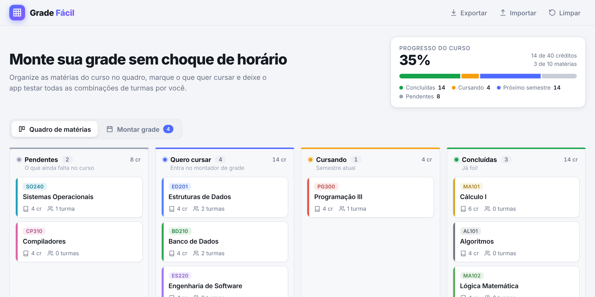
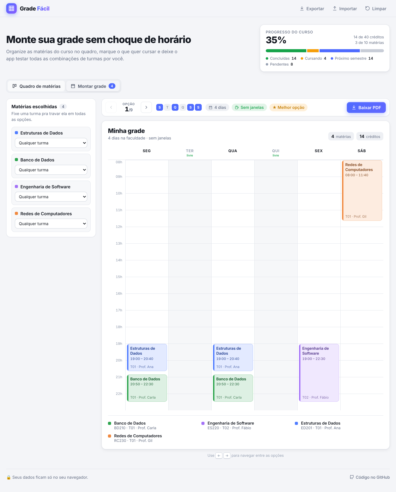

# ▦ Grade Fácil

**Planeje as matérias do curso num quadro kanban e gere automaticamente todas as grades horárias possíveis, sem choque de horário. Depois é só baixar em PDF.**

🔗 **[Abrir o app](https://samuelvendrame.github.io/grade-facil/)**



## O problema

Toda época de matrícula é a mesma coisa: várias matérias, cada uma com duas ou três turmas em horários diferentes, e você tentando montar na mão, numa planilha, uma combinação que não tenha choque e que, se possível, não te faça ir pra faculdade todo dia.

O Grade Fácil resolve isso: você cadastra as turmas uma vez e ele testa todas as combinações pra você.

## Funcionalidades

- **Quadro kanban do curso**: arraste as matérias entre `Pendentes`, `Quero cursar`, `Cursando` e `Concluídas`, com progresso do curso por créditos.
- **Montador automático de grade**: pega o que está em *Quero cursar* e gera **todas as combinações de turmas sem conflito**.
- **Ranking das opções**: as grades aparecem ordenadas por **menos dias na faculdade** e **menos janelas** entre aulas.
- **Fixar turma**: quer muito a turma de um professor específico? Trave ela e veja só as opções compatíveis.
- **Encaixe parcial**: se não der pra cursar tudo junto, o app mostra as combinações que encaixam o **máximo de matérias** e diz quais ficaram de fora.
- **Exportar em PDF**: baixe a grade escolhida em A4 paisagem, pronta pra imprimir ou mandar no grupo da turma.
- **Exportar e importar JSON**: compartilhe o cadastro das turmas com os colegas.
- **Sem login e sem servidor**: tudo fica salvo no `localStorage` do seu navegador.
- Tema claro e escuro automático, responsivo e com drag-and-drop no celular.



## Como funciona o montador

O núcleo fica em [`src/scheduler.ts`](src/scheduler.ts): um **backtracking** que, para cada matéria, tenta cada turma compatível com as já escolhidas (e também tenta *pular* a matéria, pro caso de não haver solução completa).

- As matérias com menos turmas são testadas primeiro, pra podar a árvore mais cedo.
- Um ramo é descartado quando já não consegue igualar a melhor quantidade de matérias encaixadas.
- Duas aulas chocam quando são no mesmo dia e `inicioA < fimB && inicioB < fimA`.
- Cada combinação recebe uma pontuação (dias usados e minutos de janela, ignorando intervalos de até 20 min) e as opções são ordenadas por ela.
- Há limites de resultados e de passos pra nunca travar o navegador.

## Stack

- [React 19](https://react.dev) + TypeScript + [Vite](https://vite.dev)
- [dnd-kit](https://dndkit.com) para o drag-and-drop (mouse, toque e teclado)
- [jsPDF](https://github.com/parallax/jsPDF) + [html-to-image](https://github.com/bubkoo/html-to-image) para o PDF, carregados sob demanda
- CSS puro com variáveis (sem framework de UI)
- Deploy contínuo no GitHub Pages via GitHub Actions

## Rodando localmente

```bash
git clone https://github.com/SamuelVendrame/grade-facil.git
cd grade-facil
npm install
npm run dev
```

Testes do algoritmo: `npm test` · Build de produção: `npm run build` (gera a pasta `dist/`).

## Estrutura

```
src/
├── App.tsx               # estado global, abas, import/export
├── scheduler.ts          # algoritmo de geração das grades
├── scheduler.test.ts     # testes do algoritmo (Vitest)
├── pdf.ts                # exportação para PDF
├── storage.ts            # localStorage + JSON
├── sample.ts             # dados de exemplo
├── types.ts
└── components/
    ├── Kanban.tsx        # quadro com drag-and-drop
    ├── MateriaModal.tsx  # cadastro de matéria, turmas e horários
    ├── Montador.tsx      # tela de opções de grade
    └── Grade.tsx         # grade semanal visual
```

## Próximos passos

- [ ] Pré-requisitos entre matérias (bloquear em *Quero cursar* se faltar o pré-requisito)
- [ ] Compartilhar o planejamento por link
- [ ] Exportar a grade para o Google Calendar (.ics)
- [ ] Preferências no ranking (ex.: "não quero aula sexta")

## Licença

[MIT](LICENSE)
